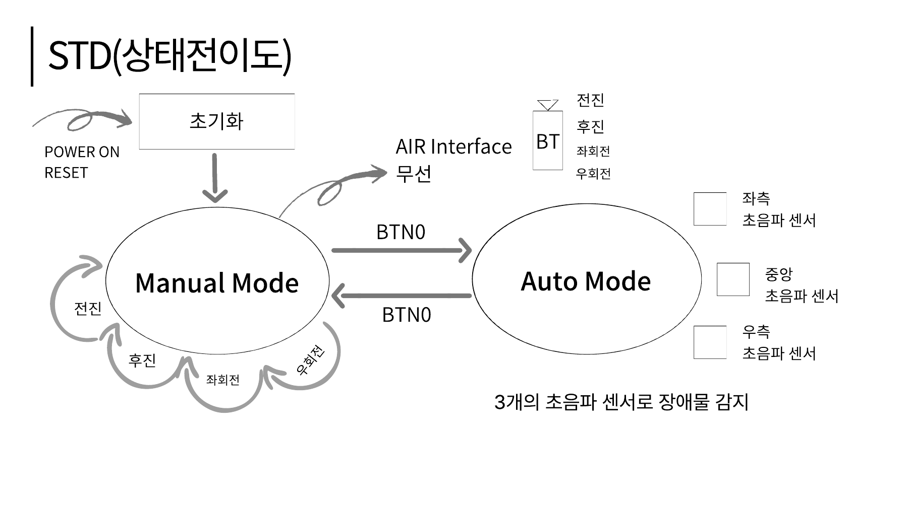
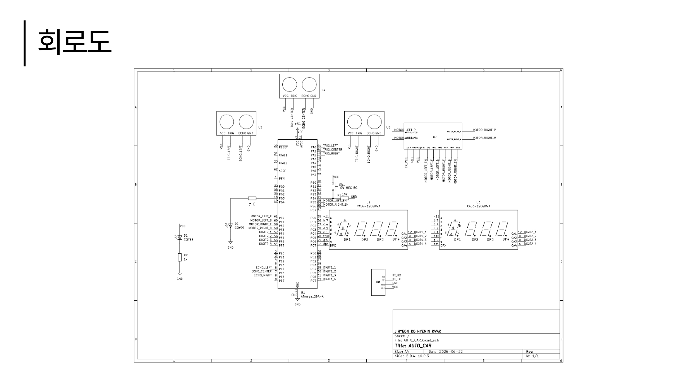

# AVR 기반 초음파 자율주행 RC카

ATmega128A와 3개의 초음파 센서를 이용해 장애물을 감지하고, Bluetooth 수동주행과 장애물 회피 주행을 구현한 프로젝트입니다.

**개발자:** 고지현 · 곽혜민  
**발표자료:** [프로젝트 발표 PDF](./AVR%20%EA%B8%B0%EB%B0%98%20%EC%B4%88%EC%9D%8C%ED%8C%8C%20%EC%9E%90%EC%9C%A8%EC%A3%BC%ED%96%89%20RC%EC%B9%B4_%EA%B3%A0%EC%A7%80%ED%98%84_%EA%B3%BD%ED%98%9C%EB%AF%BC.pdf)

## 목차

1. [프로젝트 개요](#1-프로젝트-개요)
2. [FSM 및 회로도](#2-fsm-및-회로도)
3. [Part List](#3-part-list)
4. [동작 구현](#4-동작-구현)
5. [코드 설명](#5-코드-설명)
6. [Trouble Shooting](#6-trouble-shooting)
7. [요소 기술 설명](#7-요소-기술-설명)
8. [개선할 점](#8-개선할-점)

## 1. 프로젝트 개요

### 프로젝트 목적

ATmega128A의 GPIO, UART, Timer, PWM을 실제 주행 시스템에 적용하고, **센서 입력 → 주행 판단 → 모터 제어 → 상태 표시**로 이어지는 임베디드 시스템을 구현합니다.

### 주요 기능

| 기능 | 구현 내용 |
| --- | --- |
| 수동주행 | 스마트폰에서 Bluetooth로 전송한 문자 명령을 UART1으로 수신해 전진·후진·좌회전·우회전·정지 |
| 자동주행 | 전방·좌측·우측 HC-SR04 측정값을 이용한 장애물 회피 |
| 구동 제어 | Timer1의 두 PWM 채널과 모터 드라이버 방향 신호로 좌우 구동부 제어 |
| 모드 전환 | BTN0 입력으로 수동주행에서 자동주행으로 전환하거나 자동주행 종료 |
| 주행 상태 표시 | 4자리 FND 두 개로 주행시간 카운트, 방향 문자, 원형 애니메이션 표시 |
| 주행 결과 조회 | 종료 후 주행시간·후진 횟수·좌회전 횟수·우회전 횟수 순서로 조회 |

### 개발 환경

| 항목 | 내용 |
| --- | --- |
| MCU | ATmega128A |
| 클록 기준 | `F_CPU = 16000000UL` / 16MHz |
| 언어 | C |
| 프로젝트 형식 | Atmel Studio 7 계열 AVR-GCC 프로젝트 |
| 프로젝트 파일 | [07.AUTO_CAR_1.cproj](07.AUTO_CAR_1.cproj) |
| 통신 | Bluetooth 모듈 ↔ UART1, 9600bps 기준 |

`F_CPU`는 코드와 지연 함수가 사용하는 클록 기준값입니다. 실제 MCU의 발진기·퓨즈 설정과 일치해야 UART 속도와 시간 계산이 맞습니다.

## 2. FSM 및 회로도

### 2.1 FSM

발표자료 22쪽의 상태전이도입니다.



현재 코드에서는 `func_state`로 수동·자동 모드를 구분하고, 결과 조회 여부는 `drive_finished`로 따로 관리합니다.

| 현재 상태 | 입력 | 처리 및 다음 상태 |
| --- | --- | --- |
| 전원 인가 / 리셋 | 초기화 완료 | `MANUAL_MODE`에서 시작 |
| 수동주행 | `F/B/L/R` 또는 소문자 | 해당 방향으로 모터 제어 |
| 수동주행 | BTN0 누름·해제 | 정지와 기존 BT 명령 초기화 후 `AUTO_MODE` 진입 |
| 자동주행 | 초음파 측정 결과 | 전진·회전·후진 판단 반복 |
| 자동주행 | BTN0 누름·해제 | 정지, 주행 종료 처리, 수동모드로 변경하면서 결과 조회 시작 |
| 수동주행 | `S/s` | 정지, 주행 종료 처리, 결과 조회 시작 |
| 결과 조회 | BTN0 누름·해제 | `t → b → L → r` 순서로 항목 변경 |
| 마지막 결과 조회 후 | BTN0 누름·해제 | 기록 초기화 후 수동주행 대기 |

결과 조회는 별도의 주행 모드가 아닙니다. 현재 코드는 결과 조회 중 이동 명령을 차단하지 않으며, 자동모드에서는 `S/s`를 처리하지 않습니다. 두 항목 모두 개선 대상입니다.

### 2.2 회로도

발표자료 23쪽의 회로도입니다. 이미지를 클릭하면 확대해서 확인할 수 있습니다.

[](docs/images/circuit.png)

### 2.3 PIN MAP

| 기능 | ATmega128A 핀 | 코드 구현 |
| --- | --- | --- |
| 좌측 / 전방 / 우측 TRIG | PA0 / PA1 / PA2 | `ultrasonic.h` |
| 좌측 / 전방 / 우측 ECHO | PE4 / PE5 / PE6 | `ultrasonic.h` |
| 좌측 PWM / 우측 PWM | PB5(OC1A) / PB6(OC1B) | `pwm.c` |
| 모터 드라이버 IN1~IN4 | PF0~PF3 | `pwm.c` |
| 모드 버튼 BTN0 | PB4 | `button.h` |
| UART1 RX / TX | PD2(RXD1) / PD3(TXD1) | MCU UART1 핀 기능 |
| FND 세그먼트 a~g, dp | PC0~PC7 | `fnd.h` |
| 위 FND 자리 선택 | PD4 / PD5 / PD6 / PD7 | `fnd.h`, `fnd_digit_on()` |
| 아래 FND 자리 선택 | PF4~PF7 | `fnd.h` |

## 3. Part List

발표자료 5쪽의 부품 목록을 기준으로 정리했습니다.

| 부품 | 수량 | 용도 |
| --- | --- | --- |
| ATmega128A Demo Board | 1 | 주행 판단, 통신, 모터·표시 제어 |
| HC-SR04 | 3 | 좌측·전방·우측 거리 측정 |
| Bluetooth Module | 1 | 스마트폰과 무선 명령 송수신 |
| DC Motor | 4 | RC카 구동 |
| Motor Driver | 1식 | 좌우 구동부의 방향 및 PWM 제어 |
| 4-Digit FND | 2 | 주행 상태와 결과 표시 |
| Tact Switch | 1 | BTN0 모드 전환 및 결과 조회 |

## 4. 동작 구현

### 4.1 Manual Mode

스마트폰에서 전송한 문자 한 바이트를 UART1 수신 인터럽트에서 `bt_data`에 저장하고, `manual_mode()`의 `switch`문에서 주행 명령으로 해석합니다.

| 수신 문자 | 호출 함수 | 동작 | PWM 비교값 |
| --- | --- | --- | --- |
| `F`, `f` | `forward(500)` | 전진 | 좌 500 / 우 500 |
| `B`, `b` | `backward(500)` | 후진 | 좌 500 / 우 500 |
| `L`, `l` | `turn_left(700)` | 좌회전 | 좌 0 / 우 700 |
| `R`, `r` | `turn_right(700)` | 우회전 | 좌 700 / 우 0 |
| `S`, `s` | `stop()` | 정지 및 주행 종료 | 좌 0 / 우 0 |

`speed` 인자는 RPM이 아니라 `OCR1A/OCR1B`에 기록하는 비교값입니다. 회전은 한쪽 구동부의 PWM을 0으로 하고 반대쪽을 구동하는 방식입니다.

BTN0를 누르고 떼면 정지 후 자동주행으로 전환합니다. `S/s`로 종료하면 결과 조회를 시작합니다.

### 4.2 Auto Mode

#### 기준값

| 정의 | 값 | 의미 |
| --- | --- | --- |
| `FRONT_SAFE_CM` | 15cm | 전방 전진 판단 기준 |
| `SIDE_SAFE_CM` | 15cm | 측면 막힘 판단 기준 |
| `SIDE_CRASH_CM` | 10cm | 측면 근접 판단 기준. 실제 조건은 `< 10` |
| `AUTO_SPEED` | 300 | 전진·후진 PWM 비교값 |
| `TURN_SPEED` | 450 | 회전 PWM 비교값 |
| `MAX_ECHO_US` | 30000 | ECHO 대기·측정 루프의 제한 기준 |

#### 현재 코드의 실행 순서

1. 전방 거리를 측정하고 40ms 대기합니다.
2. 전방이 15cm보다 멀면 전진하고 함수를 반환합니다.
3. 전방이 15cm 이하이면 정지하고 80ms 대기합니다.
4. 좌측과 우측을 순차 측정하며 각각 40ms 대기합니다.
5. 아래 분기를 위에서부터 검사하고, 처음 만족한 동작을 실행합니다.

| 우선순위 | 조건 | 동작 및 설정된 대기 |
| --- | --- | --- |
| 1 | 전방 > 15cm | 전진 후 반환 |
| 2 | 전방 ≤ 15cm, 좌측 < 10cm | 우회전 후 350ms 대기 |
| 3 | 앞선 조건 불만족, 우측 < 10cm | 좌회전 후 350ms 대기 |
| 4 | 앞선 조건 불만족, 좌측 ≤ 15cm, 우측 > 15cm | 우회전 후 350ms 대기 |
| 5 | 앞선 조건 불만족, 우측 ≤ 15cm, 좌측 > 15cm | 좌회전 후 400ms 대기 |
| 6 | 앞선 조건 불만족, 좌우 모두 ≤ 15cm | 후진 350ms 대기 → 정지 80ms 대기 → 넓은 방향으로 회전 후 400ms 대기 |
| 7 | 전방은 막혔지만 좌우 모두 > 15cm | 더 넓은 방향으로 회전 후 250ms 대기. 같으면 우회전 |

현재는 전방이 열려 있으면 좌우를 측정하지 않습니다. 또한 좌우가 모두 10cm 미만일 때도 우선순위 2가 먼저 적용되므로, 양측 막힘 후진 분기로 진입하지 않습니다.

회전 대기 후에는 즉시 `stop()`을 호출하지 않습니다. 따라서 표의 시간은 **대기 설정값**이며, 실제 회전 출력은 다음 모터 명령이 실행될 때까지 유지될 수 있습니다.

### 4.3 FND 표시와 주행 결과

| 구분 | 위 FND | 아래 FND |
| --- | --- | --- |
| 주행 중 | 주행시간 카운트 | `F / b / L / r / S`와 원형 애니메이션 |
| 결과 page 0 | `fnd_run_sec` | `t`: 주행시간 |
| 결과 page 1 | `fnd_backward_count` | `b`: 후진 횟수 |
| 결과 page 2 | `fnd_left_count` | `L`: 좌회전 횟수 |
| 결과 page 3 | `fnd_right_count` | `r`: 우회전 횟수 |

주행시간은 `MOTION_STOP`이 아니고 주행이 종료되지 않았을 때 누적됩니다. 후진·회전 횟수는 해당 방향 함수가 반복 호출된 횟수가 아니라, 이전 동작과 다른 동작으로 진입한 시점을 기준으로 증가합니다.

발표자료 30~31쪽에는 자동·수동주행 시연 장면이 포함되어 있습니다. 저장소의 PDF는 정적 자료이므로 이 README에서 재생 가능한 영상으로 연결하지는 않았습니다.

## 5. 코드 설명

### 5.1 파일별 역할

| 파일 | 역할 | 주요 함수·변수 |
| --- | --- | --- |
| [main.c](main.c) | 주변장치 초기화, 모드 선택, 수동 명령 처리, FND 갱신 호출 | `main()`, `manual_mode()`, `auto_mode()`, `mode_button_check()`, `func_state` |
| [def.h](def.h) | 모드 상수 정의 | `MANUAL_MODE`, `AUTO_MODE` |
| [pwm.c](pwm.c), [pwm.h](pwm.h) | Timer1 PWM과 모터 방향 제어 | `init_timer1_pwm()`, `forward()`, `backward()`, `turn_left()`, `turn_right()`, `stop()` |
| [ultrasonic.c](ultrasonic.c), [ultrasonic.h](ultrasonic.h) | TRIG 생성, ECHO 측정, 거리 환산, 자동주행 판단 | `ultrasonic_read_cm()`, `ultrasonic_auto()` |
| [uart1.c](uart1.c), [uart1.h](uart1.h) | Bluetooth 명령 수신과 수신 문자 에코 | `USART1_RX_vect`, `bt_data`, `UART1_transmit()` |
| [button.c](button.c), [button.h](button.h) | 버튼 입력과 누름·해제 상태 확인 | `init_button()`, `get_button()` |
| [fnd.c](fnd.c), [fnd.h](fnd.h) | FND 스캔, 표시 데이터 구성, 시간·동작 횟수 관리 | `TIMER2_OVF_vect`, `fnd_update()`, `fnd_set_motion()`, `fnd_finish_drive()` |

### 5.2 메인 루프

```c
while (1)
{
    mode_button_check();

    if (func_state == MANUAL_MODE)
        manual_mode();
    else
        auto_mode();

    fnd_update();
}
```

UART 수신과 FND 자리 스캔은 인터럽트에서 실행합니다. 모드 선택, 주행 판단, 표시 데이터 구성은 메인 루프에서 수행합니다. 자동주행 함수가 오래 걸리면 다음 버튼 확인과 `fnd_update()` 호출도 늦어집니다.

`def.h`에 정의된 `AUTO_MODE_CHECK`, `DISTANCE_CHECK`는 현재 메인 루프의 별도 실행 모드로 사용하지 않습니다. 세 센서를 10ms 간격으로 읽는 `ultrasonic_processing()`도 현재 메인 주행 경로에서 호출되지 않습니다.

### 5.3 모터 제어

Timer1을 Fast PWM 모드 14로 설정하고 `ICR1=1023`을 TOP으로 사용합니다. `OCR1A`는 왼쪽, `OCR1B`는 오른쪽 PWM 비교값입니다. 방향은 PF0~PF3으로 설정하며, 각 주행 함수에서 FND 동작 상태도 함께 갱신합니다.

```c
void turn_left(int speed)
{
    fnd_set_motion(MOTION_LEFT);
    // 방향 신호는 전진으로 설정
    OCR1A = 0;
    OCR1B = speed;
}
```

위 코드는 원본 함수의 동작을 설명하기 위해 방향 설정 부분을 주석으로 줄인 발췌입니다. 전체 구현은 `pwm.c`에서 확인할 수 있습니다.

### 5.4 초음파 측정

`ultrasonic_read_cm()`은 TRIG를 LOW 2us, HIGH 10us, 다시 LOW로 설정합니다. 이후 ECHO 상승을 기다리고 HIGH 유지시간을 누적해 `echo_time / 58`로 cm 단위 거리를 계산합니다. ECHO 대기나 HIGH 측정이 제한값에 도달하면 `400`을 반환합니다.

현재 구현은 소프트웨어 반복문을 이용한 측정입니다. Timer3나 ECHO 외부 인터럽트를 사용한 측정은 아직 구현되어 있지 않습니다.

### 5.5 주행 기록과 표시

`fnd_set_motion()`은 현재 동작을 갱신하고, 후진·좌회전·우회전에 새로 진입하면 해당 횟수를 증가시킵니다. `fnd_finish_drive()`는 결과 조회를 시작하고, `fnd_next_result_page()`는 조회 항목을 변경합니다.

FND의 세그먼트 데이터는 `top_data[]`, `bottom_data[]`에 보관합니다. Timer2 ISR이 8개 자리를 순환하며 출력하고, 메인 루프의 `fnd_update()`가 배열 내용을 구성합니다. **자리 스캔과 표시 내용 갱신은 서로 다른 작업**입니다.

## 6. Trouble Shooting

현재 코드에 반영된 대응을 정리했습니다. 실기 재시험 결과가 없는 항목은 완전 해결로 표시하지 않고, 남은 문제를 8절에 구분했습니다.

### 6.1 ECHO 응답 이상으로 측정에서 계속 기다리는 문제

| 단계 | 내용 |
| --- | --- |
| **문제 발생** | ECHO가 정상적으로 들어오지 않거나 HIGH 상태가 지속되면 거리 측정에서 계속 기다리며 차량이 반응하지 않을 수 있었다. |
| **원인 분석** | ECHO 상승 대기와 HIGH 유지시간 측정 루프에 탈출 조건이 필요했다. |
| **해결 방안** | `timeout`, `echo_time`에 제한 조건을 두어 함수가 반환되도록 구현했다. ECHO 대기 자체에 갇히는 가능성에 대응했다. |

반환값 `400`을 정상 거리처럼 사용하는 문제는 남아 있습니다. 또한 소프트웨어 누적값이므로 실제 제한시간이 정확히 30ms라고 보장되지는 않습니다.

### 6.2 초음파 센서 간 간섭 완화

| 단계 | 내용 |
| --- | --- |
| **문제 발생** | 여러 센서를 사용할 때 다른 센서의 반사파가 측정값에 영향을 줄 수 있었다. |
| **원인 분석** | 동일 주파수의 센서를 짧은 간격으로 동작시키면 이전 반사파가 다음 측정에 섞일 수 있다. |
| **해결 방안** | 자동주행에서 센서를 순차 측정하고 측정 사이에 40ms 대기를 배치했다. 발사 간격을 확보하는 방식으로 간섭 완화를 시도했다. |

부분 개선 항목입니다. 장착 각도·반사 환경과 발사 간격에 대한 추가 검증이 필요합니다.

### 6.3 장애물 회피 분기와 막다른 공간의 탈출 동작

| 단계 | 내용 |
| --- | --- |
| **문제 발생** | 전방이 막힌 상황에서 회피 방향을 정하기 어렵거나 회전만으로 공간을 벗어나지 못할 수 있었다. |
| **원인 분석** | 좌우 여유 공간과 양측 막힘을 구분하는 동작이 필요했다. 임계값과 같은 거리의 처리도 명확해야 했다. |
| **해결 방안** | 전방 장애물 감지 후 정지·좌우 측정을 수행하고, 측면 조건에 따라 반대쪽으로 회전하도록 했다. 양측 막힘 분기에는 후진 후 거리 비교를 추가했고, `<=` 조건과 마지막 방향 선택 분기를 포함했다. |

양측 초근접 분기의 우선순위, 후진 후 재측정, 임계거리 반복 동작은 아직 개선 대상입니다.

## 7. 요소 기술 설명

### 7.1 GPIO와 비트 제어

GPIO의 방향은 `DDRx`, 출력값은 `PORTx`, 입력값은 `PINx`로 다룹니다. 비트 마스크를 이용하면 같은 포트에서 다른 기능이 사용하는 비트를 보존하며 필요한 비트만 변경할 수 있습니다.

```c
DDRB |= (1 << 5);        // PB5 출력 설정
DDRB &= ~(1 << 4);       // PB4 입력 설정
```

프로젝트에서는 PF0~PF3을 모터 방향에, PF4~PF7을 FND 자리 선택에 사용합니다. PF4~PF7의 JTAG 기능과 GPIO 사용이 겹치므로 `init_fnd()`에서 JTAG 비활성화 처리를 합니다. 핀 기능과 레지스터 정의는 [ATmega128A 데이터시트][ref-mcu]를 참고했습니다.

### 7.2 UART: 비동기 직렬 통신

UART는 공통 클록선 없이 송수신 속도와 프레임 형식을 맞춰 통신합니다. TX와 RX는 교차 연결하고 기준 전위가 같도록 GND를 공유합니다. 8N1 프레임은 시작 1비트, 데이터 8비트, 패리티 없음, 정지 1비트로 구성됩니다.

현재 코드는 `U2X1=1`, `UBRR1=207`로 9600bps에 가까운 속도를 설정합니다. 16MHz에서 비동기 배속 모드의 계산값은 다음과 같습니다.

```text
Baud = F_CPU / (8 × (UBRR1 + 1))
     = 16,000,000 / (8 × 208)
     ≈ 9,615.4 bps
```

9600bps 기준 오차는 약 +0.16%입니다. 수신 인터럽트는 문자 도착 시 실행되지만, 수신한 명령의 실제 주행 적용은 메인 루프에서 진행됩니다. [Microchip USART 설정 자료][ref-uart]를 참고했습니다.

### 7.3 Bluetooth와 UART의 역할 구분

스마트폰과 Bluetooth 모듈 사이에서는 무선 통신이 이루어지고, Bluetooth 모듈과 ATmega128A 사이에서는 UART로 문자 데이터를 전달합니다. MCU 코드는 RF 채널을 직접 제어하지 않고 수신 문자에 따라 모터 동작을 결정합니다.

발표자료에서 다룬 Bluetooth Classic(BR/EDR)은 2.4GHz ISM 대역의 79개 채널과 주파수 도약을 사용합니다. 채널을 바꾸며 통신하고, AFH는 간섭이 큰 채널을 피하도록 채널 사용을 조정하는 방식입니다. Classic과 LE는 채널 구성이 다르므로 동일하게 설명하면 안 됩니다. 사용 모듈의 상세 모델·버전은 저장소만으로 확정하지 않았습니다. [Bluetooth SIG 기술 개요][ref-bluetooth]와 [BR/EDR 베이스밴드 규격][ref-afh]을 참고했습니다.

### 7.4 PWM과 모터 제어

| 구분 | 정보를 표현하는 방식 |
| --- | --- |
| PAM | 펄스의 진폭을 변경 |
| PWM | 펄스의 HIGH 유지시간, 즉 펄스폭을 변경 |

이 프로젝트는 PWM의 듀티를 바꿔 모터에 전달되는 평균 구동량을 조절합니다. MCU 핀은 모터 드라이버에 제어 신호를 전달하며, 모터 전류를 직접 공급하지 않습니다.

Timer1의 설정값으로 계산한 PWM 주기는 다음과 같습니다.

```text
분주 후 타이머 주파수 = 16MHz / 64 = 250kHz
카운터 한 칸 = 4us
PWM 주기 = (ICR1 + 1) × 4us = 1024 × 4us = 4.096ms
PWM 주파수 ≈ 244.14Hz
```

| 비교값 | 근사 듀티 |
| --- | --- |
| 300 | 약 29.3% |
| 450 | 약 43.9% |
| 500 | 약 48.8% |
| 700 | 약 68.4% |

`speed=500`은 500ms나 500RPM을 의미하지 않습니다. 주행 방향은 별도의 IN1~IN4 신호로 결정합니다. PWM 원리는 [Microchip AVR 타이머 자료][ref-timer]를 참고했습니다.

### 7.5 HC-SR04와 거리 계산

HC-SR04는 최소 10us의 TRIG HIGH 입력을 받으면 40kHz 초음파를 발사합니다. 반사파를 이용해 ECHO 펄스폭으로 거리를 표현합니다. 자료의 측정 범위는 약 2~400cm입니다.

초음파는 물체까지 갔다가 돌아오므로 왕복 시간을 반으로 나눠야 합니다.

```text
거리 = 음속 × 왕복 시간 / 2
거리(cm) ≈ ECHO HIGH 시간(us) / 58
```

정확도는 물체의 크기·기울기·재질, 주변 온도와 반사 환경에 영향을 받습니다. 제조사 자료는 측정 주기를 60ms보다 길게 둘 것을 권장합니다. 현재 코드의 40ms 대기와 소프트웨어 시간 누적은 별도 개선 대상입니다. [HC-SR04 제조사 자료][ref-hcsr04]를 참고했습니다.

### 7.6 Timer와 FND 멀티플렉싱

두 개의 4자리 FND를 한 자리씩 빠르게 바꿔 켜는 멀티플렉싱으로 표시합니다. 세그먼트 출력은 공유하고 자리 선택 신호를 순환시키므로, 8자리 전체를 위한 별도 세그먼트 버스를 둘 필요가 없습니다. 공통 애노드 기준으로 세그먼트 데이터를 반전해 출력합니다.

현재 Timer2 설정은 `CS22=1`, 나머지 클록 선택 비트 0으로 **256분주**입니다. `TCNT2=131`을 기준으로 명목 스캔 간격은 약 2ms이며, 8자리 한 주기는 약 16ms입니다. 소스 주석의 64분주·0.5ms와 다릅니다.

```text
Timer2 명목 간격 = (256 - 131) × 256 / 16,000,000
                 = 0.002s = 2ms
```

분주비는 [ATmega128A 데이터시트][ref-mcu], 멀티플렉싱 원리는 [Microchip AVR242][ref-fnd]를 참고했습니다.

### 7.7 Polling과 Interrupt

| 구분 | 원리 | 현재 프로젝트의 사용 예 |
| --- | --- | --- |
| Polling | 코드가 입력·상태를 직접 반복 확인 | 버튼 확인, ECHO HIGH/LOW 대기 |
| Interrupt | 이벤트 발생 시 ISR 실행 | UART1 수신, Timer2 FND 자리 스캔 |

Polling 자체가 항상 느리거나 인터럽트가 항상 빠른 것은 아닙니다. 응답시간은 확인 주기, ISR 실행시간, 인터럽트 금지 구간과 다른 작업의 대기시간에 영향을 받습니다. 현재 코드에서는 긴 `_delay_ms()`가 주행 판단을 늦추고, UART 수신 ISR 안의 송신 대기가 다른 ISR을 지연시킬 수 있습니다.

### 7.8 volatile과 원자 접근

`volatile`은 컴파일러가 해당 변수의 접근을 임의로 생략하지 않도록 하는 데 사용합니다. 하지만 한 번에 접근할 수 없는 크기의 값을 여러 명령으로 읽는 상황까지 보호하지는 않습니다.

8비트 AVR에서 ISR과 메인이 공유하는 16비트 값은 읽기·쓰기가 도중에 끊길 수 있으므로, 필요한 구간을 `ATOMIC_BLOCK(ATOMIC_RESTORESTATE)` 등으로 보호해야 합니다. [avr-libc 원자 접근 문서][ref-atomic]를 참고했습니다.

### 7.9 참고 자료

- [ATmega128A 데이터시트][ref-mcu]
- [Microchip megaAVR USART Configuration][ref-uart]
- [Bluetooth SIG Technology Overview][ref-bluetooth]
- [Bluetooth SIG BR/EDR Baseband Specification][ref-afh]
- [Microchip AVR MCU Timer Overview][ref-timer]
- [HC-SR04 제조사 데이터시트][ref-hcsr04]
- [Microchip AVR242: FND 멀티플렉싱][ref-fnd]
- [avr-libc: 원자 접근][ref-atomic]
- [Microchip AVR042: 전원·RESET 하드웨어 설계][ref-power]

## 8. 개선할 점

아래는 **현재 소스에 아직 적용되지 않은 개선안**입니다. 기존 함수와 변수 구조를 기준으로 문제 위치, 해결 방향, 적용할 기술을 정리했습니다.

### 8.1 코드 개선 항목

| 코드에서 문제가 발생할 여지가 있는 부분 | 해결 방안 | 적용할 요소 기술 |
| --- | --- | --- |
| `ultrasonic_read_cm()`의 타임아웃 반환값 `400`이 정상 거리로 해석되어 전진하거나 잘못된 회전 방향을 선택할 수 있다. | 실패를 `-1` 등 정상 거리와 구분하고, 거리 비교 전에 오류를 확인해 정지·재측정한다. | 오류 반환값, 입력 유효성 검사, 오류 시 정지 |
| `ultrasonic_auto()`의 긴 대기 중 버튼 확인과 새 주행 판단을 진행하지 못한다. 후진·회전 경로의 대기는 측정시간 외에도 약 1,030ms 누적된다. | 함수 내부에 동작 상태·시작 시각을 두고 경과시간으로 동작을 종료한다. ECHO 측정 대기도 함께 비차단으로 바꾼다. | 타이머, 비차단 처리, FSM |
| 측정 후 40ms 대기만으로 센서 간 간섭 방지를 보장하기 어렵다. | 발사 시각을 기준으로 간격을 관리하고 제조사 권장값과 실제 반사 환경을 반영한다. | 센서 순차 구동, 측정 스케줄링 |
| `_delay_us(2)`와 `echo_time += 2`가 실제 경과시간을 그대로 나타내지 않으며, 단일 거리값을 바로 판단에 사용한다. | Timer3 카운터로 펄스폭을 측정하고 정상값에 중앙값 필터를 적용한다. 극근접 원시값은 별도 우선 처리한다. | 하드웨어 타이머, 펄스폭 측정, 중앙값 필터 |
| 전진·회피 기준이 모두 전방 15cm여서 경계 부근에서 동작이 반복될 수 있다. | 예를 들어 15cm 이하에서 회피에 진입하고 20cm 이상에서 전진으로 복귀하도록 구분한다. | 히스테리시스, 이전 상태 유지 |
| 전방이 15cm보다 멀면 바로 반환하므로 전진 중 측면 근접 상황을 놓칠 수 있다. | 전진 중에도 좌우를 주기적으로 갱신하고 충돌 위험 조건을 우선 처리한다. | 다중 센서 판단, 주기적 갱신 |
| 좌우가 모두 8cm여도 `left < 10` 분기에서 우회전하며 양측 막힘 후진 분기를 건너뛴다. | 양측 막힘 조건을 개별 측면 조건보다 먼저 검사한다. | 조건 분기 우선순위 |
| 후진 후에도 후진 전에 저장한 좌우 거리를 비교한다. | 후진 종료 후 새 측정값을 확보한 뒤 회전 방향을 결정한다. | 센서 재측정, 데이터 갱신 시점 관리 |
| `S/s`가 `manual_mode()`에만 있어 자동주행에서는 정지 명령이 적용되지 않는다. | 모드 판단 전에 공통 정지 요청을 확인하고, 처리 전까지 별도 플래그로 유지한다. | 공통 이벤트 처리, 우선순위, 정지 플래그 |
| `bt_data` 한 바이트 덮어쓰기로 명령이 유실될 수 있고, 수신 ISR에서 송신을 기다린다. | 유효 명령만 보관하고 수신·소비를 구분한다. 필요하면 링 버퍼를 사용하고 송신 대기를 ISR 밖으로 옮긴다. | 수신 플래그, 링 버퍼, 짧은 ISR, 송신 인터럽트 |
| `get_button()`은 15ms 대기 후 입력을 재확인하지 않아 노이즈를 이벤트로 인정할 수 있다. | 일정 시간 같은 입력이 유지됐는지 확인하고, 안정된 누름·해제를 한 번의 이벤트로 처리한다. | 디바운싱, 주기적 샘플링, 에지 검출 |
| Timer2는 실제 256분주인데 64분주로 계산했다. 주행시간 표시가 실제보다 약 네 배 느려질 수 있다. | 64분주인 `CS21 | CS20`으로 보정하거나, CTC 방식으로 일정한 시간 기준을 만든다. | 분주비 계산, 타이머 주기 계산, CTC |
| `current_motion`, `drive_finished`, `one_second_count` 등 공유 상태와 16비트 카운터의 접근이 충분히 보호되지 않았다. | 필요한 `volatile`을 적용하고 공유 값의 읽기·초기화를 짧은 원자적 구간에서 수행한다. | volatile, 임계구역, ATOMIC_BLOCK |
| FND ISR과 모터 함수가 PORTF의 서로 다른 비트를 갱신하므로 read-modify-write가 겹치면 FND 자리 선택이 오래된 값으로 덮일 수 있다. | 공유 포트 갱신을 원자적으로 보호하고 다른 기능의 비트를 보존한다. | 비트 마스킹, 공유 자원 보호 |
| 결과 조회 중에도 `manual_mode()`가 이동 명령을 처리해 차량이 움직일 수 있다. | 결과 조회와 주행 허용 상태를 구분하고, 조회 종료 전에는 이동 명령을 차단한다. | 상태별 입력 허용, 명령 게이팅 |

[ref-mcu]: https://ww1.microchip.com/downloads/en/DeviceDoc/Atmel-8151-8-bit-AVR-ATmega128A_Datasheet.pdf
[ref-uart]: https://developerhelp.microchip.com/xwiki/bin/view/products/mcu-mpu/8-bit-avr/peripherals/usart/8-bit-avr-usart-mega-configuration/
[ref-bluetooth]: https://www.bluetooth.com/learn-about-bluetooth/tech-overview/
[ref-afh]: https://www.bluetooth.com/wp-content/uploads/Files/Specification/HTML/Core-61/out/en/br-edr-controller/baseband-specification.html
[ref-timer]: https://developerhelp.microchip.com/xwiki/bin/view/products/mcu-mpu/8-bit-avr/peripherals/timers-counters/8-bit-avr-avrtimerover/
[ref-hcsr04]: https://cdn.sparkfun.com/datasheets/Sensors/Proximity/HCSR04.pdf
[ref-fnd]: https://www.microchip.com/en-us/application-notes/an1231
[ref-atomic]: https://avrdudes.github.io/avr-libc/avr-libc-user-manual/group__util__atomic.html
[ref-power]: https://ww1.microchip.com/downloads/en/appnotes/atmel-2521-avr-hardware-design-considerations_applicationnote_avr042.pdf
